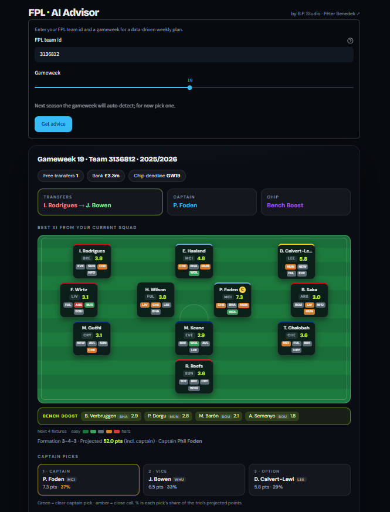
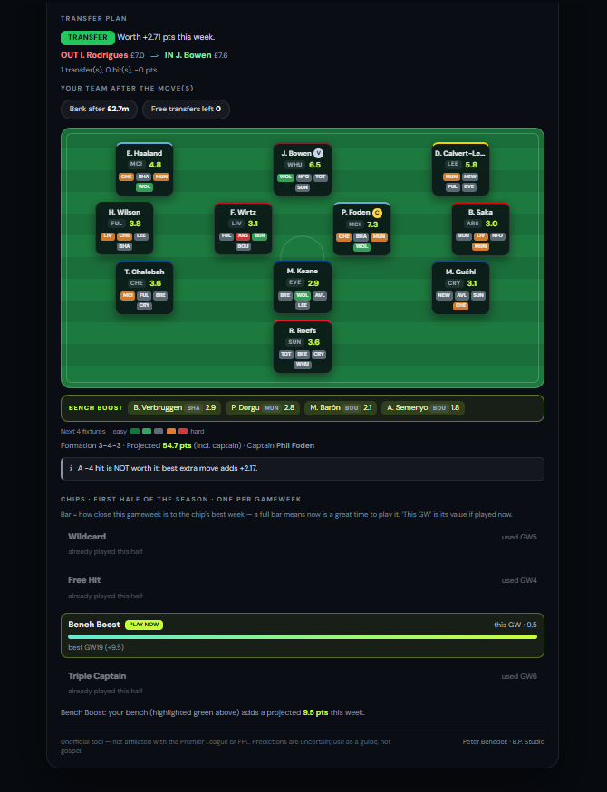

# FPL AI Advisor

[](https://github.com/benedekpepe/fpl-ai-advisor/actions/workflows/ci.yml)

**Live demo: https://fpl-ai-advisor.streamlit.app/**

A decision aid for [Fantasy Premier League](https://fantasy.premierleague.com/).
Before the season starts it **builds your opening squad from scratch**; once
gameweeks are played it advises the best **captain**, **transfer(s)** (weighing
form against fixtures, including whether a −4 hit is worth taking) and **chip
timing** — all driven by a points-prediction model and a constrained
squad optimiser, behind a Streamlit dashboard.

> **Unofficial.** Not affiliated with, endorsed by, or connected to the Premier
> League or Fantasy Premier League. Built for personal use and as a portfolio
> project.

> **Status.** Runs live for the 2026-27 season (`FPL_DATA_SOURCE=live`): before
> gameweek 1 it shows the **squad builder**; once the first deadline passes it
> switches to **weekly advice** on your team. Advice targets the earliest gameweek
> whose deadline is still open, using only completed, FPL-checked rounds for form.
> A finished-season **demo** (2025-26) is also available
> (`FPL_DATA_SOURCE=csv`), where you can try the advisor on any team ID and a
> past gameweek.

## Two modes

- **Squad builder** — the optimal 15-man squad built from scratch: for the start
  of the season (before any gameweek) in the dashboard, and available via the CLI
  later in the season. Weekly advice can also propose Wildcard or Free Hit squads.
  Optionally **pin** must-have players, tick **Bench Boost** to build all 15 for
  the immediate gameweek, and see each pick's upcoming
  fixtures. Every player shows both its **this-gameweek** projection and its
  **next-4-average**. When there's no current-season form yet, projections are
  **seeded from last season**.
- **Weekly advice** — once the season is underway (the first deadline has
  passed): captain, transfer(s) with the hit math, best XI, and chip timing for
  the **upcoming** gameweek (the one you can still change), projected from *this*
  season's form. Each player's next few gameweeks are built from their played
  games and scored against the actual upcoming fixtures, so every card shows both
  a **this-gameweek** projection and a **next-4 average** (starters and bench).
  In the opening weeks it also **dampens price** (so a pricey flop doesn't outrank
  an in-form cheap player) and **blends in season-to-date points-per-game**.
  Price damping fades over the first four completed rounds; form blending peaks
  early, then gradually falls to a 15% contribution. If the main forecast is
  unavailable, the app labels its **seeded estimate**, using completed current-season
  form where possible and previous-season form otherwise.

## What it does

- **Squad builder** — the best legal 15 (2/5/5/3, valid formation, ≤ 3 per club,
  budget), with the starting XI, captain, optional pinned picks, and each
  player's upcoming fixtures shown on the pitch.
- **Captain** — the highest projected scorer in your starting XI, regardless of
  position; the captain candidates and vice-captain follow the same projections.
- **Transfers** — candidate swaps are compared on discounted next-four-gameweek
  point totals, with each extra transfer's one-off −4 cost deducted. Known selling
  prices are used; incomplete budget estimates are labelled.
- **Best XI** — the optimal lineup and formation from your current 15, with each
  player's next-4 fixtures and difficulty (FPL's own FDR) on the card.
- **Chip timing** — compares each unused chip within the available forecast
  window and recommends a week near its projected peak when the gain clears a
  threshold. Free Hit targets unusually large weekly shortfalls; Wildcard weighs
  sustained improvement. On the expiry week, positive gains are considered even
  below normal saving thresholds. Missing forecast data is shown explicitly.
- **Availability-aware** — unavailable players are excluded as buys. Your own
  unavailable players stay in the squad with zero projected points and can be
  replaced or benched when alternatives permit; injury and doubt flags are shown
  at the top of the advice. Lineup, transfer and chip forecasts use the same
  availability snapshot.
- **Expected-points selection** — the default objective maximises projected
  points without a hidden penalty for opposing players. Correlation changes risk,
  not the sum of expected points. The optional conflict penalty is disabled.
- **Consistent live gameweeks** — advice targets the earliest open deadline;
  form uses only finished, FPL-checked gameweeks. The UI shows the form cutoff,
  while injuries and upcoming fixtures stay live. Both normal and fallback
  projections use the same target gameweek.
- **Saved forecast review** — export a live recommendation before its deadline,
  then upload it after the round to compare predictions, saved lineups and
  transfer returns with completed, FPL-checked results.

## Screenshots




These show the core dashboard layout; the current build also includes forecast
status, lineup explanations, the validation panel and saved-forecast review
described below.

## How it works

1. **Ingestion** — the public FPL API for live team state, prices, fixtures and
   availability, and the community
   [vaastav/Fantasy-Premier-League](https://github.com/vaastav/Fantasy-Premier-League)
   dataset for per-gameweek history. Per-gameweek data is read through a
   configurable source (see *Data source* below).
2. **Features** — rolling and season-to-date form use only prior observations;
   both matches in a double share pre-gameweek form. Unplayed future rows do not
   consume the rolling window. Minutes/starts trends, home/away and opponent
   attack/defence strengths provide context. Uninitialised live opponent ratings
   use labelled prior-season/neutral estimates instead of zero-strength inputs.
3. **Model** — a two-stage expected-points model: `P(plays) × E[points | plays]`,
   each stage a LightGBM model. Splitting "will they play" from "how well" handles
   rotation better than a single regressor.
4. **Cold start & early season** — before any gameweek, form is seeded from each
   player's **previous-season** per-game averages,
   joined to this season's players by their permanent FPL `code` (ids change
   between seasons). Players with no previous-season data (new signings, promoted
   clubs, youth) get a position + price based estimate; players whose permanent code
   didn't carry between seasons are recovered by name. The builder blends the next few
   gameweeks so upcoming fixtures matter, picks the 15 for that run, and then
   sets the starting XI on the immediate gameweek.
5. **Optimiser** — a mixed-integer program (PuLP) that picks the 15-man squad,
   the starting XI and the captain to maximise projected points (captain counted
   twice) under the real rules, with an optional **stack-aware** penalty that
   discourages starting opposing players from the same match. The same engine
   powers the builder, the best-XI choice and the transfer planner.
6. **Advisor** — reconstructs your free-transfer count, applies live availability,
   runs the transfer/hit math and the chip-timing logic.
7. **Dashboard** — a Streamlit app that renders the pitch, the recommended moves
   and the chip plan, and shows the right mode for where the season is.

### Data source

Per-gameweek data is read through one switch, the `FPL_DATA_SOURCE` environment
variable, so the same code serves local development, the hosted demo and the
in-season live mode:

- **`db`** (default) — local Postgres, the historical dataset loaded by the
  ingestion scripts; used to train and backtest the model.
- **`csv`** — the vaastav CSVs pulled directly at runtime, no database; this is
  what the finished-season demo uses (2025-26).
- **`live`** — the live FPL API (2026-27): open-deadline detection, completed-round
  form, current availability, squad building and weekly advice; see `src/ingestion/live.py` and
  `src/model/preseason.py`.

## Model performance

Chronological evaluations use separate training and later test seasons. Lower
MAE/RMSE is better. These evaluate isolated comparison models, not the deployed
artifact.

| Training | Test | Model + form MAE | Simple form MAE | Model + form RMSE |
| --- | --- | ---: | ---: | ---: |
| 2023-24 | 2024-25 | 1.0112 | 1.0711 | 1.9595 |
| 2024-25 | 2025-26 | 0.9932 | 1.0581 | 1.9701 |

Reports: [first holdout](docs/model_validation.json),
[second holdout](docs/model_validation_second.json). Eight variants were compared.
No alternative consistently improves all principal error measures across both
seasons, so production blending weights remain unchanged.

The all-player averages include many inactive players with zero points. For
players whose prior average minutes are at least 60, MAE is **2.24 points** in
2024-25 and **2.37 points** in 2025-26. The observed-minute guide has an average
absolute error of **23.9 / 24.2 minutes** among players with at least 30 prior
average minutes; it is not a separately trained minutes forecast. Reports also
break down point errors by position and playing-probability calibration.
Assistant Manager coach rows are excluded from player training and benchmarks.
The measured position biases do not justify a blanket position adjustment.

These replace the earlier pipeline benchmark. Historical opponent-strength
snapshots may have later revisions, and archived injury/availability news is not
replayed. They do not establish the accuracy of the current live model. Use the
validation command below to reproduce the first comparison.

## Tech stack

Python · PostgreSQL (Docker) · pandas · LightGBM · scikit-learn · scipy · PuLP ·
Streamlit.

## Project structure

```
fpl-ai-advisor/
├── app.py                  # Streamlit dashboard (auto-detects builder vs advice)
├── conftest.py             # makes `src` importable in tests
├── docker-compose.yml      # local Postgres service
├── requirements.txt
├── .env.example
├── models/                 # trained model (two_stage_v3.pkl included; retrain via python -m src.model.model)
├── src/
│   ├── config.py           # all constants in one place
│   ├── data/               # loaders: history (db / csv), team strengths
│   ├── db/                 # schema, connection, init
│   ├── ingestion/          # FPL API client, historical loader, live mode
│   ├── model/              # features, projections, validation, forecast review, cold start
│   ├── optim/              # squad / XI / captain optimiser
│   ├── advisor/            # advice assembly + CLI
│   └── ui/                 # forecast explanations and validation panels
└── tests/                  # unit tests (no DB/model/network)
```

## Getting started

The app reads per-gameweek data from a configurable source (the
`FPL_DATA_SOURCE` environment variable — see *Data source* above).

**Try it without a database.** Create the virtual environment and install
dependencies (step 2 below), then run either mode:

```bash
# Finished-season demo (2025-26): enter a team ID + a past gameweek in the app
FPL_DATA_SOURCE=csv streamlit run app.py

# Live (2026-27): squad builder before GW1, weekly advice after the first deadline
FPL_DATA_SOURCE=live streamlit run app.py
# Windows (PowerShell): $env:FPL_DATA_SOURCE="live"; streamlit run app.py
```

For the full local setup with Postgres (used to train the model and ingest live
state), follow the steps below.

### Prerequisites

- **Python 3.11+**
- **Docker** (for the local Postgres container), or a native Postgres
- **Git**

### 1. Start the database

```bash
docker compose up -d db
```

### 2. Create a virtual environment and install dependencies

```bash
python -m venv .venv
source .venv/bin/activate        # Windows (PowerShell): .venv\Scripts\Activate.ps1
pip install -r requirements.txt
```

### 3. Configure the environment (optional)

The defaults already match the Docker service, so this is only needed if you
change the database settings:

```bash
cp .env.example .env             # Windows: copy .env.example .env
```

### 4. Create the tables

```bash
python -m src.db.init_db
```

### 5. Load historical data

Pulls per-gameweek history for the given seasons into Postgres (used to train and
backtest the model):

```bash
python -m src.ingestion.load_history 2022-23 2023-24 2024-25 2025-26
```

### 6. Train the model

```bash
python -m src.model.model
```

This trains the two-stage model on seasons earlier than the configured test
season, prints its evaluation and saves the artifact to `models/`. It replaces
that local model file. The two comparison reports above are generated separately
with `src.model.validate`, which does not replace the deployed artifact.

### 7. Run the app

```bash
FPL_DATA_SOURCE=live streamlit run app.py
```

## Command line

Build an opening squad for the upcoming (unplayed) gameweek from the live API,
seeded from last season — optionally pinning must-have players:

```bash
python -m src.model.preseason               # optimal opening squad
python -m src.model.preseason --pin Haaland # force a must-have pick
```

The in-season advisor also runs without the dashboard:

```bash
python -m src.advisor.personal <team_id> <gameweek>
# e.g. python -m src.advisor.personal 1234567 16
```

## Forecast transparency and validation

The pitch keeps the target-GW projection and weighted next-four-gameweek average.
A double gameweek sums both match projections; a blank contributes zero to the
run average. The ticker groups both opponents in one GW cell and marks blanks.
Future unplayed rows do not consume the recent-form window, and both matches of
a double use the same pre-gameweek form.

**Your lineup, explained** compares every bench player with a legal single-player
swap, before captain bonus. Expand a player to inspect observed minutes, recent
starts, form, xGI and the model's per-match chance of any minutes. Observed average
minutes are a guide, not a new calibrated starting/minutes model. Seed estimates
use season-average signals and are labelled separately. The forecast banner
shows when the main model has fallen back to a seeded forecast.

Run the isolated chronological evaluation without replacing the live artifact:

```sh
python -m src.model.validate --cache-dir work/validation --output docs/model_validation.json
```

It trains on 2023-24 and tests on 2024-25, comparing the current recency blend,
stronger/lighter blends, model-only, form-only, a minutes guard, recent-five form
and sample-aware blending. A second report trains on 2024-25 and tests on 2025-26.
The checked-in reports are exploratory: the minutes guard lowers MAE but increases RMSE, so production
weights remain unchanged. Historical opponent-strength snapshots may contain later
revisions; archived injury/availability news is not replayed. Confirm tuning on an
additional untouched season before adopting it. The UI's Model check panel reports
this separate evaluation, not measured performance of the current deployed artifact.


## Saved forecasts and result review
The live view's **Keep & review a forecast** section exports the exact prediction
and recommendation before the deadline. Keep the JSON file and upload it there
later to compare with finished, FPL-checked results. App results survive review
and download reruns; advice whose deadline has passed is not reused.

The snapshot includes stable player IDs, timestamps, projection/rating sources,
the model and scoring-pipeline hashes, the saved lineups and transfer IDs. It is
checksummed to detect accidental changes, not digitally authenticated. Late
snapshots are rejected. Only fully finished, FPL-checked rounds are evaluated;
pending or missing player results do not silently become zero points.

Capture and evaluate from the CLI:

```sh
python -m src.model.monitor capture --team-id 1234567 --directory data/forecast_logs
python -m src.model.monitor evaluate data/forecast_logs/<snapshot>.json --output data/review.json
```

Set `FPL_FORECAST_LOG_DIR` to append snapshots automatically whenever live advice
is generated. Use a persistent/mounted directory for that setting. The default
cloud filesystem is temporary; no durable central store or unattended deadline
scheduler is enabled by default. Downloaded files remain usable independently.
The ignored `data/` directory keeps local team snapshots out of Git.

Evaluation reports player errors and bias by position, single-fixture playing
probability calibration, and the error of the observed-minute guide. The target
week's saved lineups are scored with legal automatic substitutions, vice-captain
fallback and hit costs. The multiweek comparison measures ownership points for
the transferred players; it does not claim to reproduce future manual lineups or
captain changes. Earlier live recommendations cannot be proved accurate without
snapshots saved before their deadlines.

## Decision audit

- Captain and vice-captain can be any starting position; no hidden attacker-only filter.
- Transfer gains are discounted next-four-GW **totals**, compared against a one-off
  four-point hit. They remain a fixed-squad outlook, not a full dynamic transfer plan.
- Known acquisition prices use FPL's half-profit selling-price rule. Public transfer
  history and initial prices are used where available; incomplete budgets are labelled.
- The original squad is restored for advice after a current Free Hit.
- Wildcard/Free Hit preserve banked FTs without granting another; the GW16 AFCON
  top-up applies only to 2025-26. Optional FT override is available in Team settings.
- Chip comparisons use the manager's budget, blank-week zeroes, current availability
  and seeded per-week forecasts when necessary. An expiring chip with positive gain
  is considered even below the normal save-it-for-later threshold. No-data is not a hold verdict.
- Live opponent strengths use positive, finite bootstrap ratings. Zero or missing
  values fall back to the last completed season, matched by club code; unmatched
  clubs use the valid ratings' median, and the UI discloses those estimates. Historical form weights
  use only rounds before the target, and genuine double-GW appearances are not clipped
  to a round count.

Rules checked against [official transfer guidance](https://www.premierleague.com/en/news/2174907/1000),
[official chip guidance](https://www.premierleague.com/en/news/2174900) and
[2026-27 changes](https://www.premierleague.com/en/news/4679873).

## Tests

Tests cover formation and budget constraints, captain choice, transfer hits and
selling prices, chip expiry, Free Hit reversion, free-transfer rules, forecast
cutoffs, double/blank weeks, escaped UI explanations, snapshot integrity,
pre-deadline capture, incomplete results, legal automatic substitutions and
advice retention across review reruns. They use synthetic inputs
and mocked models/APIs, so no database, trained artifact or network is required:

```bash
pytest -q
```

They also run automatically on every push and pull request via GitHub Actions
(Python 3.11 and 3.12) — see the CI badge at the top.

## Deployment

The app runs on Streamlit Community Cloud with **no database**. One setting on
the host decides what it is:

- `FPL_DATA_SOURCE=live` — the live 2026-27 tool: squad builder before GW1,
  weekly advice after the first deadline.
- `FPL_DATA_SOURCE=csv` — the finished-season demo (2025-26), reading the vaastav
  CSVs at runtime; anyone can try the advisor with a team ID and a past gameweek.

An optional `app_password` secret can gate access to invited users. Install from
`requirements.txt`: PuLP is pinned to 3.3.2 because the optimiser uses its 3.x API.

## Notes and limitations

- **Cold start.** Before any gameweek there's no current-season form, so early
  projections are seeded from last season and are correspondingly uncertain; the
  seed also compresses the gap between elite and mid-price players, so premiums
  and captaincy calls are worth your own judgement (that's what `--pin` is for).
- **Availability** comes from the live API (`status`, `chance_of_playing`), so it
  is only applied in live mode, not in the finished-season demo. Current availability
  is held constant across the forecast window; future recovery dates are not modelled.
- It projects your **current** squad forward, so it can't foresee future squad
  improvements from transfers — early-window chip peaks can read a little eager.
- **Public team state** has limits: selling prices and free transfers may be
  estimated, and unfinalised changes in your account are not visible. Check the
  displayed budget and optionally override the FT estimate in Team settings.
- FPL has high inherent variance. The aim is systematically better-than-gut
  decisions with honest uncertainty, not a crystal ball.

## License & data

Code released under the [MIT License](LICENSE).

Historical gameweek data comes from the
[vaastav/Fantasy-Premier-League](https://github.com/vaastav/Fantasy-Premier-League)
dataset (MIT licensed), and live data from the official FPL API. This project is
unaffiliated with the Premier League / Fantasy Premier League and does not
redistribute their data — it is fetched at runtime.

## Author

Built by **Péter Benedek** — B.P. Studio
[Portfolio](https://benedekpeter.netlify.app/) · [GitHub](https://github.com/benedekpepe) · [LinkedIn](https://www.linkedin.com/in/benedek-d-peter/)
